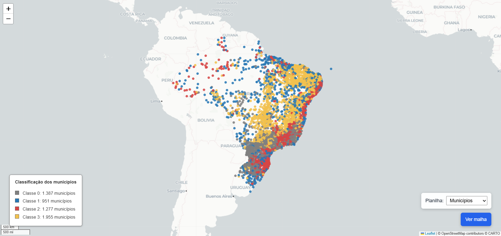

# Mapa com municípios clusterizados

Esse é um mapa para visualização da aplicação do algoritmo K-means em municípios do Brasil.

**Resumo:** Este trabalho tem como objetivo identificar perfis de infraestrutura urbana entre os municípios brasileiros a partir de indicadores das características urbanísticas do entorno dos domicílios do Censo Demográfico 2022. São utilizados dados do IBGE referentes aos 5.570 municípios brasileiros. Inicialmente, realiza-se uma análise exploratória para avaliar a pertinência, variabilidade e correlação das variáveis disponíveis e selecionar indicadores com potencial para diferenciar os municípios. Posteriormente, os indicadores selecionados serão utilizados em técnicas de clusterização, buscando identificar grupos de municípios com características urbanísticas semelhantes no contexto do ODS 11

    

